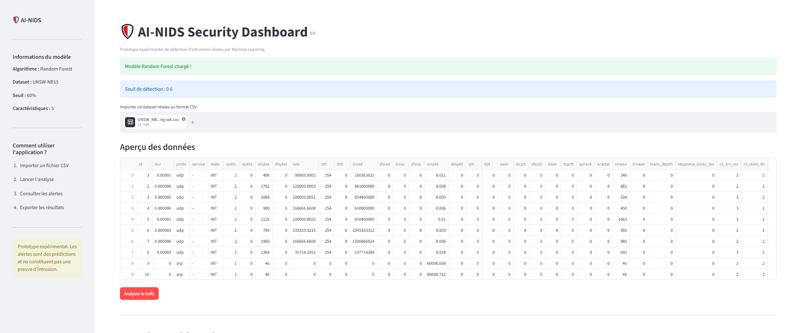
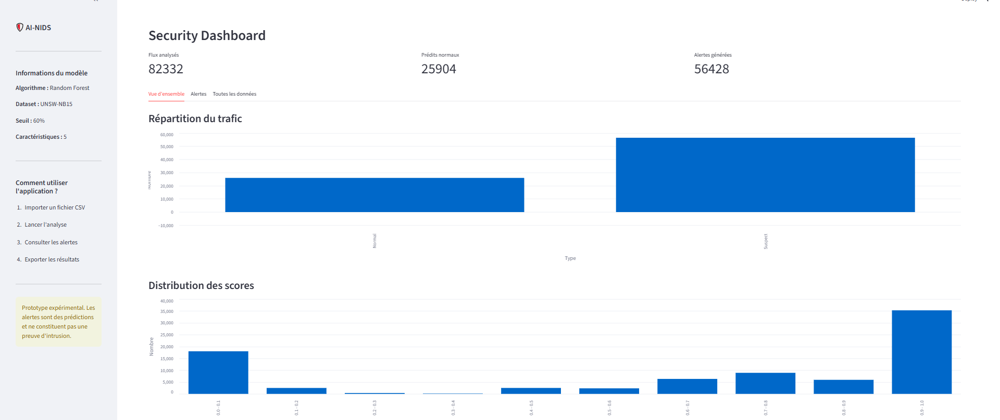

# 🛡️ AI-NIDS
## AI-Powered Network Intrusion Detection System

AI-NIDS is a machine learning-based prototype
designed to identify potentially malicious network
traffic using supervised classification.

The project combines cybersecurity, network traffic
analysis, machine learning and data visualization.

## Features

- Binary network traffic classification
- Decision Tree and Random Forest models
- Exploratory analysis of network traffic
- Evaluation using precision, recall and F1-score
- Confusion matrix and feature importance
- Interactive Streamlit dashboard
- CSV traffic analysis and alert export

## Technologies

- Python
- Pandas and NumPy
- Scikit-learn
- Matplotlib
- Streamlit
- Git and GitHub

## Dataset

This project uses the UNSW-NB15 dataset,
developed by the University of New South Wales.

Source:
https://research.unsw.edu.au/projects/unsw-nb15-dataset

The official dataset includes:
- 175,341 training records
- 82,332 testing records

The model uses five network-flow features:
dur, sbytes, dbytes, spkts and dpkts.

## Machine Learning

Two classification algorithms were implemented:

1. Decision Tree
2. Random Forest

The training file was split into training (80%)
and validation (20%) subsets.

The Random Forest was selected based on
validation performance.

## Results

Random Forest results on the official test set
using the default classification threshold (0.5):

| Metric | Result |
|--------|--------|
| Accuracy | 82.62% |
| Precision (attack) | 76.39% |
| Recall (attack) | 99.03% |
| F1-score (attack) | 86.25% |
| False positives | 13,872 |
| False negatives | 438 |

The model detects most attacks in the test dataset,
but produces a relatively high number of false
positives.

The Streamlit dashboard currently uses a threshold
of 0.6, selected using validation data. Dashboard
predictions therefore differ from the evaluation
results above.

## Installation

Clone the repository and install dependencies.

Create a Python virtual environment:

    python -m venv .venv

On Windows, install dependencies using:

    .\.venv\Scripts\python.exe -m pip install -r requirements.txt

Download the UNSW-NB15 training and testing CSV
files from the official source and place them
inside the data/ directory.

If the trained model file is not included, run:

    .\.venv\Scripts\python.exe train_model.py

Then launch the dashboard:

    .\.venv\Scripts\python.exe -m streamlit run app.py

## Limitations

- The model uses only five selected features.
- Evaluation is based on the UNSW-NB15 dataset.
- The false positive rate remains relatively high.
- The model does not capture live network traffic.
- The system is an educational prototype, not
  a production-ready intrusion detection solution.

## Future Improvements

- More extensive feature engineering
- Additional classification algorithms
- Cross-validation and model calibration
- Improved false positive handling
- Real-time network traffic analysis

## Dashboard Preview

## Author

BEN-YELLES MOHAMMED WALID
